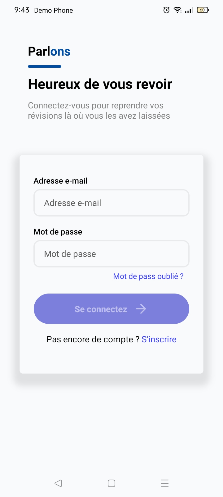
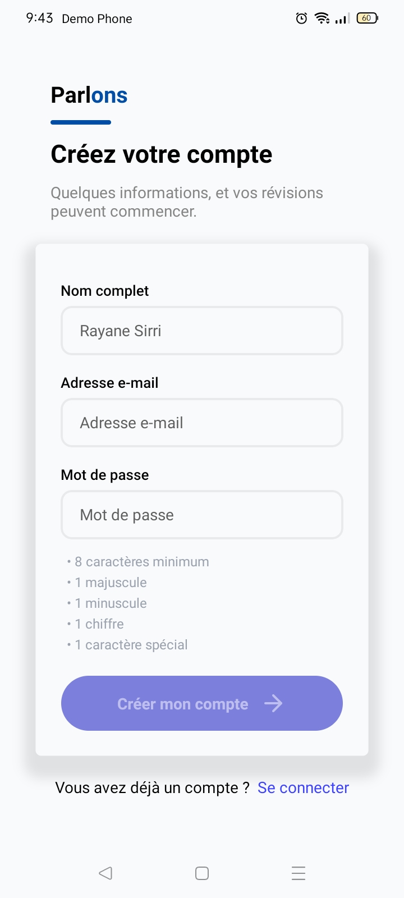
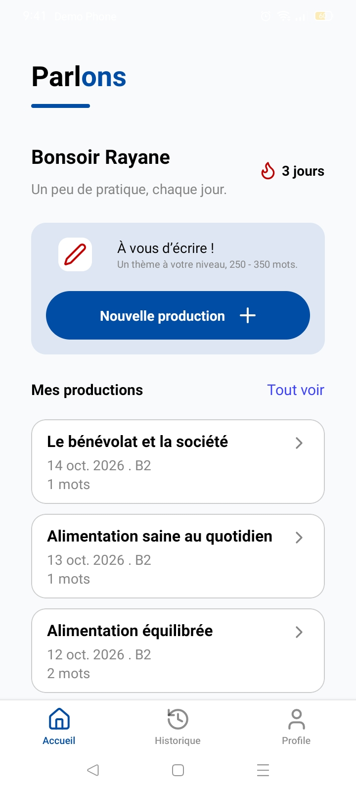
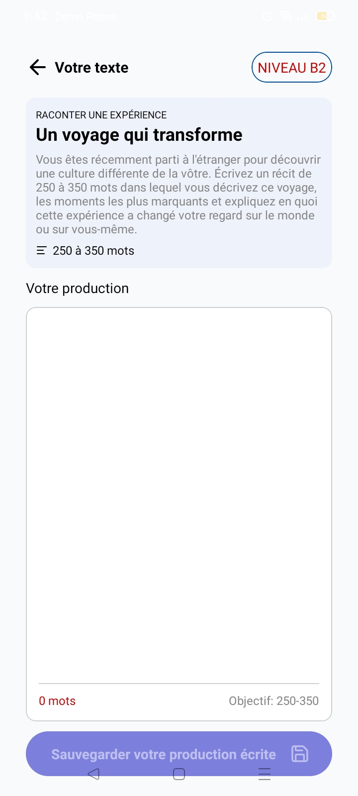
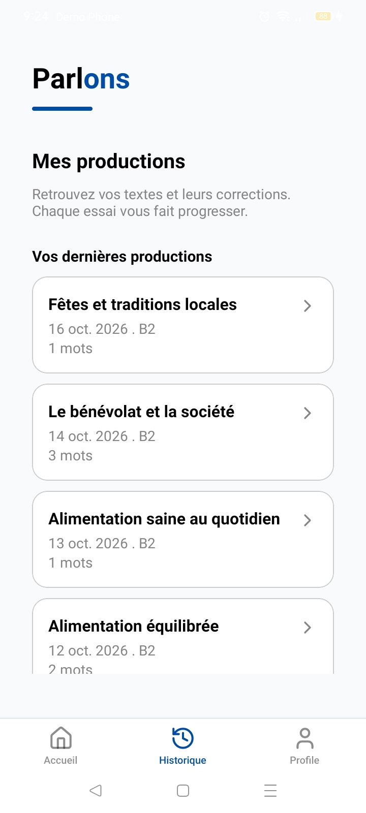

<div align="center">

 
 
 
 
 
 
 
 

</div>

# Parlons ✏️
### Entraînement à la production écrite en français
Application mobile qui permet de s'entraîner à la production écrite en français, avec des sujets générés par intelligence artificielle et adaptés au niveau CECRL (A1 à C2) de chaque utilisateur.

# Fonctionalités

| | Fonctionnalité | Description |
|---|---|---|
| 🔐 | **Authentification** | Inscription / connexion avec Supabase Auth, session persistante |
| 🎯 | **Onboarding** | Choix de **5 thèmes maximum** puis du **niveau CECRL (A1-C2)** à la première connexion |
| 🏠 | **Accueil** | Aperçu des **3 dernières productions** et bouton « Écrire » |
| 🤖 | **Sujets par IA** | **3 sujets** générés selon le niveau et les thèmes, via OpenRouter |
| 🔄 | **Régénération** | Nouveaux sujets en un clic si aucun ne convient |
| 📝 | **Écriture** | Zone de rédaction dédiée au sujet choisi, avec sauvegarde |
| 📚 | **Historique** | Consultation de toutes les productions passées |
| 🔥 | **Streak** | Série de jours consécutifs avec au moins une production, affichée sur l'accueil |
| ⭐ | **XP** | Points gagnés à chaque production, selon le nombre de mots écrits |

## Stack technique
 
| Couche | Technologie |
|---|---|
| Mobile | React Native, Expo |
| Langage | TypeScript |
| Navigation | Expo Router |
| Auth & base de données | Supabase (Auth, PostgreSQL, RLS) |
| Backend serverless | Supabase Edge Functions |
| IA | OpenRouter |
 
## Captures d'écran

<div align="center">
<table>
  <tr>
    <td align="center"></td>
    <td align="center"></td>
    <td align="center"></td>
  </tr>
  <tr>
    <td align="center"><b>Connexion</b></td>
    <td align="center"><b>Inscription</b></td>
    <td align="center"><b>Accueil</b><br/>streak et dernières productions</td>
  </tr>
  <tr>
    <td align="center"></td>
    <td align="center"></td>
    <td align="center"></td>
  </tr>
  <tr>
    <td align="center"><b>Choix des thèmes</b><br/>3 sujets générés par l'IA</td>
    <td align="center"><b>Écriture</b><br/>avec objectif de mots</td>
    <td align="center"><b>Historique</b><br/>des productions écrites</td>
  </tr>
</table>
</div>


 
---

# Structure du projet

```
app/           Expo Router screens and navigation
assets/        Logos
components/    Reusable UI pieces
constants/     Global values and styles
hooks/         Custom hooks useAuth for the current user/session
lib/           Supabase client setup
providers/     React context providers AuthProvider wrapping the app
services/      Functions that call Supabase
```

## Installation

### Prérequis
 
- [Node.js](https://nodejs.org/) (LTS)
- [Expo Go](https://expo.dev/go) ou un émulateur Android / iOS
- Un projet [Supabase](https://supabase.com/)
- Une clé API [OpenRouter](https://openrouter.ai/)

### 1. Cloner et installer
 
```bash
git clone https://github.com/real-nox/Parlons.git
cd Parlons
npm install
```
 
### 2. Variables d'environnement
 
Créer un fichier `.env` à la racine :
 
```env
EXPO_PUBLIC_SUPABASE_URL=https://xxxxxxxx.supabase.co
EXPO_PUBLIC_SUPABASE_PUBLISHABLE_KEY=votre clé publique
```
 
### 3. Configurer Supabase
 
- Créer les tables `profiles` `themes` et `essays`, activer la RLS et ajouter les politiques.
- Déployer l'Edge Function et enregistrer le secret :
```bash
supabase functions deploy generate-subjects
supabase secrets set OPENROUTER_API_KEY=votre_cle_openrouter
```

## Bases de données

**Profiles :**
```
create table public.profiles (
  id uuid not null,
  updated_at timestamp with time zone null,
  username text null,
  full_name text null,
  avatar_url text null,
  state smallint null default '1'::smallint,
  niveau text null default 'A1'::text,
  constraint profiles_pkey primary key (id),
  constraint profiles_username_key unique (username),
  constraint profiles_id_fkey foreign KEY (id) references auth.users (id) on delete CASCADE,
  constraint username_length check ((char_length(username) >= 3))
) TABLESPACE pg_default;
```

**Themes :**
```
create table public.themes (
  "idUser" uuid not null default gen_random_uuid (),
  themes text[] not null,
  categories text[] not null,
  id smallint generated by default as identity not null,
  constraint themes_pkey primary key (id),
  constraint themes_idUser_fkey foreign KEY ("idUser") references profiles (id) on delete CASCADE
) TABLESPACE pg_default;
```

**Essays :**
```
create table public.essays (
  id uuid not null default gen_random_uuid (),
  author_id uuid not null,
  theme text not null,
  level text not null,
  subject jsonb not null,
  content text not null default ''::text,
  word_count integer not null default 0,
  status text not null default 'draft'::text,
  created_at timestamp with time zone not null default now(),
  updated_at timestamp with time zone not null default now(),
  constraint essays_pkey primary key (id),
  constraint essays_author_id_fkey foreign KEY (author_id) references profiles (id) on delete CASCADE,
  constraint essays_status_check check (
    (
      status = any (array['draft'::text, 'submitted'::text])
    )
  )
) TABLESPACE pg_default;

create index IF not exists essays_author_id_idx on public.essays using btree (author_id, created_at desc) TABLESPACE pg_default;
```
 
> [!WARNING]
> Ne place **jamais** `OPENROUTER_API_KEY` dans le `.env` de l'application ni dans le code mobile : elle serait extractible du bundle.
 
### 4. Lancer
 
```bash
npx expo start
```
 
Scanne le QR code avec Expo Go, ou appuie sur `a` (Android).
 
---

## Roadmap

- [x] Authentification Supabase
- [x] Onboarding (thèmes + niveau)
- [x] Accueil avec 3 dernières productions
- [x] Génération de 3 sujets par IA
- [x] Régénération des sujets
- [x] Historique des productions
- [x] Streak et XP (calculés côté serveur)
- [ ] Calendrier d'activité mensuel
- [ ] Badges (« 7 jours d'affilée », « 10 productions »…)
- [ ] Notification de rappel pour protéger le streak
- [ ] Correction automatique par l'IA avec feedback adapté au niveau
- [ ] Statistiques de progression
- [ ] Modification des thèmes et du niveau depuis le profil
- [ ] Mode brouillon avec sauvegarde automatique
- [ ] Rappels quotidiens

---

## Contribuer
 
Les contributions sont les bienvenues.
 
1. Fork le projet
2. Crée ta branche : `git checkout -b feature/ma-fonctionnalite`
3. Commit : `git commit -m "Ajoute ma fonctionnalité"`
4. Push : `git push origin feature/ma-fonctionnalite`
5. Ouvre une Pull Request

---

## Author

**real-nox (Rayane Sirri) :** [GitHub](https://github.com/real-nox)

---

## License

ISC
